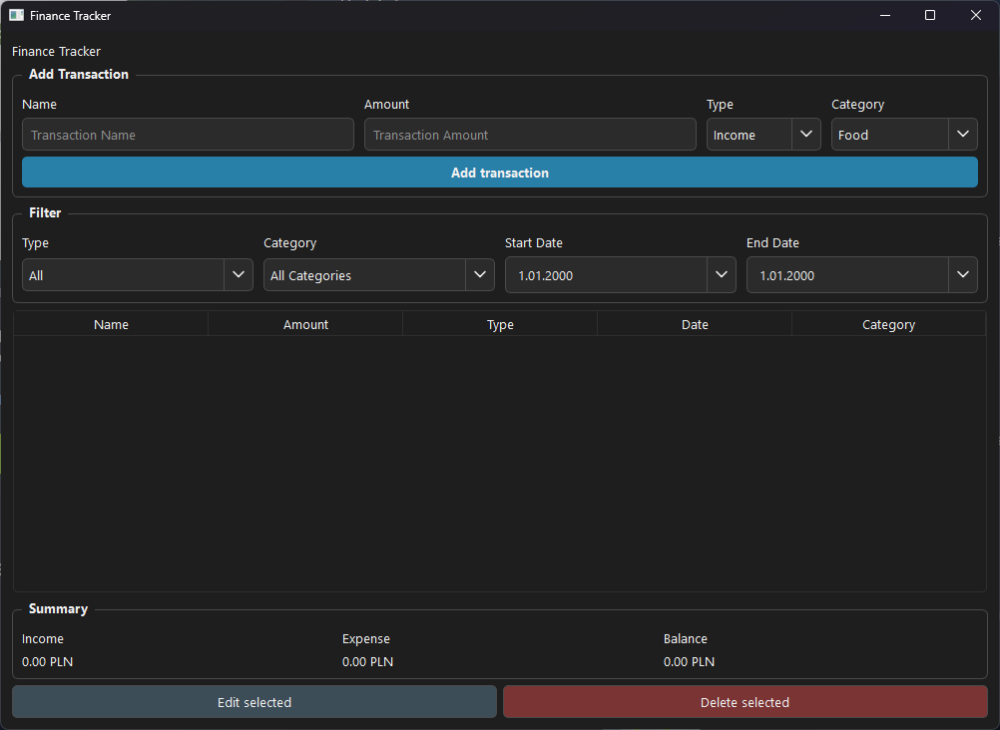

# Finance Tracker

A desktop finance tracking application built with **Python**, **PySide6**, and **SQLite**.

The project started as a command-line application and was gradually expanded into a graphical desktop application with persistent data storage, transaction management, filtering, summaries, automated tests, and a custom dark interface.

## Features

- Add income and expense transactions
- Edit existing transactions
- Delete transactions with confirmation
- Store data persistently using SQLite
- Assign categories to transactions
- Filter transactions by:
  - Type
  - Category
  - Start date
  - End date
- Dynamically update the transaction table when filters change
- Display filtered financial summaries:
  - Total income
  - Total expenses
  - Current balance
- Input validation for transaction names and amounts
- Custom dark PySide6 interface
- Automated database tests with pytest

## Technologies

- Python
- PySide6
- SQLite
- pytest
- Git / GitHub

## Project Structure

```text
finance-tracker/
│
├── gui.py
├── main.py
├── database.py
├── requirements.txt
├── README.md
│
├── assets/
│   └── icons/
│       └── chevron_down.svg
│
└── tests/
    └── test_database.py

```

`gui.py` contains the PySide6 desktop interface.

`main.py` contains the original command-line version of the application.

`database.py` handles SQLite database operations, filtering, validation, and transaction persistence.

The test suite verifies the main database operations and filtering logic.

## Screenshots

### Main Interface



## Installation

Clone the repository:

```bash
git clone https://github.com/BorysSkiba/finance-tracker/tree/gui
cd finance-tracker
```

Create a virtual environment:

```bash
python -m venv .venv
```

Activate it on Windows:

```bash
.venv\Scripts\activate
```

Install the dependencies:

```bash
pip install -r requirements.txt
```

Run the graphical application:

```bash
python gui.py
```

The SQLite database is created automatically when the application is started for the first time.

## Running Tests

Run the test suite with:

```bash
pytest
```

The tests use temporary SQLite databases, so they do not modify the application's main database.

## Database

Transactions are stored in SQLite with the following information:

- Internal ID
- Name
- Amount
- Type
- Date
- Category

The application uses parameterized SQL queries for transaction values and validates fields that may be updated dynamically.

Dates are stored using an ISO-style format:

```text
YYYY-MM-DD HH:MM:SS
```

This allows date ranges to be compared and filtered correctly.

## What I Learned

This project was built incrementally while learning and applying several software-development concepts, including:

- CRUD operations
- SQLite database integration
- Parameterized SQL queries
- Database schema changes and migrations
- Input validation
- Automated testing with pytest
- Temporary test databases
- GUI development with PySide6
- Event-driven programming
- Qt signals and slots
- Layout management
- Dynamic filtering
- Separating database logic from interface logic
- Git and GitHub workflow
- Refactoring an application as its functionality grows

## Development

The application originally stored transactions using JSON and later migrated to SQLite.

It also started as a command-line program before a PySide6 graphical interface was introduced. The original CLI version was kept as a separate entry point while the database layer was reused by both interfaces.

This incremental development process helped keep the project functional while introducing new features and restructuring existing code.

## Future Improvements

Possible future additions include:

- Charts and financial visualizations
- Additional transaction categories
- Monthly and yearly reports
- Exporting data to CSV
- Improved monetary handling using `Decimal`
- Packaging the desktop application as a standalone executable

## License

This project is intended primarily as a personal learning and portfolio project.